# 📊 Agentic BI Analyst

**Ask a bank's data a question in plain English, and get a governed, auditable answer with SQL, a chart and verified insights. Or let a team of AI agents review the whole business and test how each business line affects the others. A Data Science Lab adds causal inference, churn prediction, Hijri-calendar forecasting, A/B testing and segmentation, each validated against the truth planted in the data. The AI never writes free-form SQL and never touches personal data.**

**🚀 Live demo:** https://agentic-bi-analyst.streamlit.app/


 
 

> ⚠️ **All data is synthetic.** *Wadi Bank* is a fictional Saudi retail bank. Every customer, transaction and contract is randomly generated by [`scripts/generate_data.py`](scripts/generate_data.py). No real bank or employer data is used.

| Ask a question | Multi-agent business review | Data Science Lab |
|---|---|---|
| 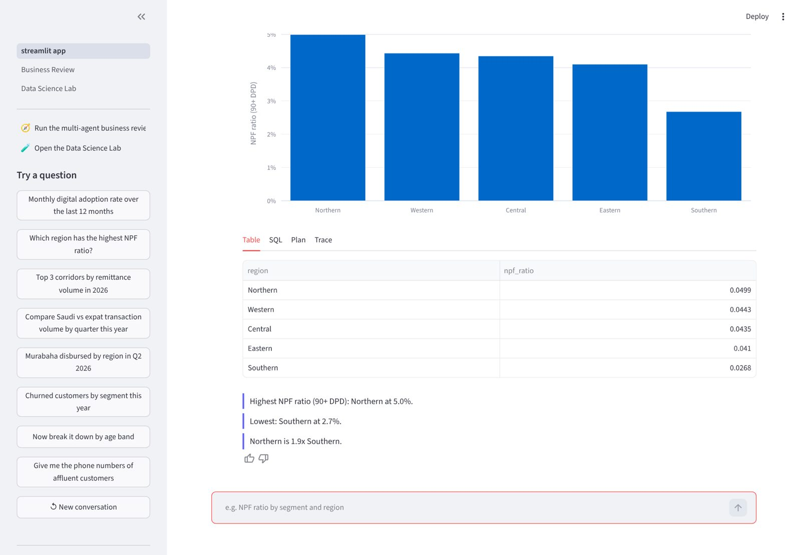 | 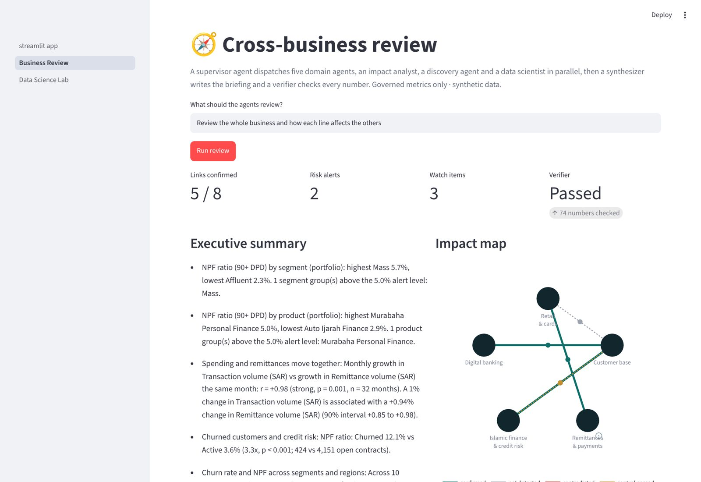 | 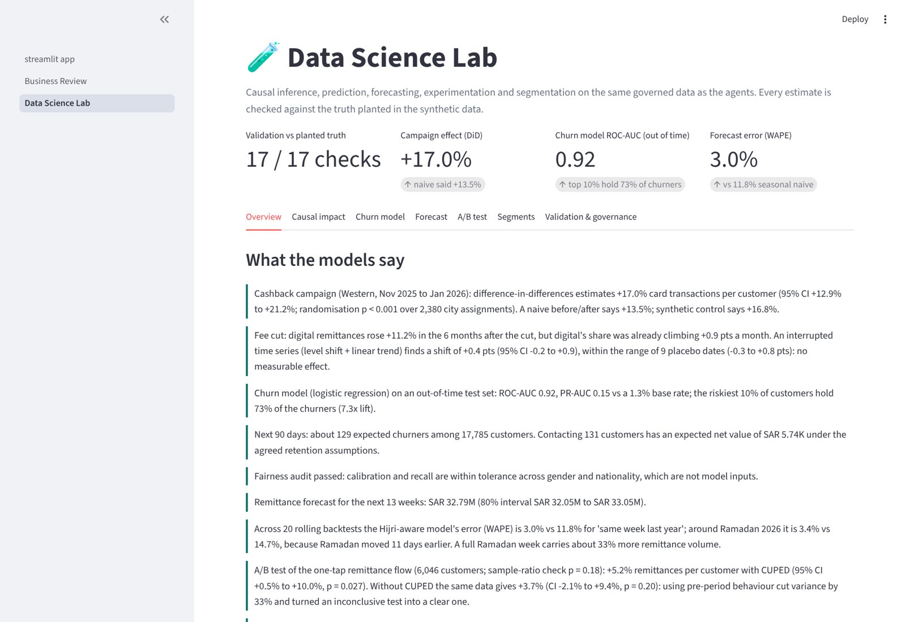 |

---

## Why this project

"Chat with your data" demos usually let an LLM write raw SQL. That breaks in a real bank:

| Problem with LLM-written SQL | What this project does instead |
|---|---|
| Two people ask the same question and get different numbers | Every metric comes from **one governed semantic layer** (YAML), the same idea as dbt MetricFlow, Power BI semantic models or Denodo derived views |
| Hallucinated joins and double counting across fact tables | A **deterministic compiler** builds SQL; multi-fact questions use CTEs (no fan-out) |
| Personal data leaks (`SELECT name, phone ...`) | **Three guardrail layers**: input guard, SQL guard and small-cell suppression (k < 10) |
| "Is it right?" is unknowable | A **golden-question eval** checks every answer against independent reference SQL in CI |
| Narratives invent numbers | Insights are **computed from the result set**. The LLM may only rephrase verified facts |

## How it works

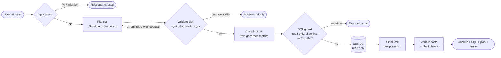

The planner only outputs a structured **QueryPlan** such as `{metrics: [npf_ratio], dimensions: [segment], start_date, ...}`. With Claude, this is enforced by a tool schema whose fields are **enums of catalog names**. If the plan is invalid, the validator's errors go back to the planner (the **self-correction loop**). Every step is recorded in a trace shown in the UI.

## Quick start (about 2 minutes, no API key needed)

**macOS / Linux, one command:** `bash scripts/setup_mac.sh --run` (installs, builds the data, runs every check and opens the app). Step-by-step guide in Indonesian: [docs/PANDUAN_ID.md](docs/PANDUAN_ID.md).

Or manually:

```bash
git clone https://github.com/vickarzz/agentic-bi-analyst.git
cd agentic-bi-analyst
python -m venv .venv && source .venv/bin/activate      # Windows: .venv\Scripts\activate
pip install -r requirements.txt

python scripts/generate_data.py      # builds data/wadi_bank.duckdb (~20k customers, ~560k transactions)
streamlit run app/streamlit_app.py   # chat UI at http://localhost:8501
```

**Optional:** to use Claude as the planner and summary writer, put `ANTHROPIC_API_KEY=...` in `.env` or your shell. Without a key, a deterministic rule-based planner runs fully offline. It is also used in CI.

Command line:

```bash
python -m bi_agent.cli --show-sql "Top 3 corridors by remittance volume in 2026"
python -m bi_agent.cli            # interactive mode; follow-ups like "now by region" keep context
```

## Example

```text
> Top 3 corridors by remittance volume in 2026

Highest Remittance volume (SAR) (2026): India at SAR 28.88M. Lowest: Pakistan at SAR 18.66M.
India is 1.5x Pakistan.

corridor remittance_volume
   India        SAR 28.88M
   Egypt        SAR 19.68M
Pakistan        SAR 18.66M

-- SQL (generated by the compiler, values bound as parameters) --
SELECT r.corridor AS corridor, SUM(r.amount_sar) AS remittance_volume,
       COUNT(DISTINCT r.customer_id) AS __n_remittances
FROM fact_remittance r
WHERE CAST(r.remittance_date AS DATE) >= '2026-01-01' AND CAST(r.remittance_date AS DATE) <= '2026-09-30'
GROUP BY ALL ORDER BY remittance_volume DESC NULLS LAST LIMIT 3
```

```text
> Churned customers by segment this year
Mass at 640 ... 1 value(s) hidden because they describe fewer than 10 customers.   ← governance at work

> Give me the phone numbers of affluent customers
I only return governed, aggregated metrics, never personal data or record-level customer details.

> NPF ratio by channel
Adjusted the question: Dimension 'channel' cannot be used with metric 'npf_ratio' (model 'finance').
NPF ratio (90+ DPD): 4.2%.                                                         ← self-correction
```

**Try these:** monthly digital adoption over the last 12 months · which region has the highest NPF ratio · Murabaha disbursed by region in Q2 2026 · compare Saudi vs expat transaction volume by quarter this year · average ticket for e-commerce by segment in 2025

## Multi-agent business review (orchestration)

One click (or `make review`) runs a **supervisor agent** that dispatches eight specialists **in parallel** and then checks their work:

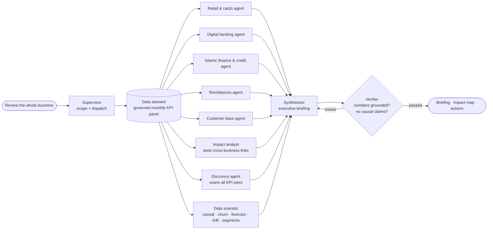

- **Domain agents** report quarter KPIs (QoQ, YoY), breakdowns, alert thresholds (e.g. NPF > 5%) and unusual months, explained with a business calendar (Ramadan, Eid, pricing changes).
- **Impact analyst** tests the cross-business hypotheses written by business owners in [`semantic/impact_links.yaml`](semantic/impact_links.yaml) with four designs: time series with lags, cross-section, cohort comparison and before/after event. It returns a verdict, effect size, permutation p-value and the owner's recommended action.
- **Discovery agent** scans every pair of KPIs (on growth rates, Bonferroni-adjusted) for co-movement nobody has hypothesised yet. These are reported as candidates, never as findings.
- **Verifier** blocks any number not computed by an agent, causal wording ("drives", "causes") and weak "confirmed" claims. With the Claude writer enabled, rejected drafts go back for rewriting.

What the agents find in the synthetic data:

| Link | Verdict | Evidence |
|---|---|---|
| Churned customers and credit risk | ✅ confirmed | NPF ratio 12.1% for churned vs 3.6% for active customers (3.3x, p < 0.001) |
| Spending and remittances move together | ✅ confirmed | monthly growth r = +0.98; 1% more spending is associated with +0.94% remittances |
| Fee cut and revenue per remittance | ✅ confirmed | SAR 18.05 → SAR 13.59 per transfer (-24.7%) after the digital fee cut |
| Fee cut and remittance activity | ➖ not detected | YoY growth 12.8% before vs 14.1% after (p = 0.82): **the fee cut gave up revenue without a measurable volume lift** |
| Control: gender vs credit risk | 🧪 control passed | no significant difference, so the method does not find links everywhere |

```bash
python -m bi_agent.orchestrator                                   # whole business → reports/business_review.md + .json
python -m bi_agent.orchestrator "focus on credit risk and churn"  # supervisor narrows the scope
```

In the app, open **Business Review** in the sidebar for the impact map, per-link evidence charts, correlation heatmap and agent timeline.

## Data Science Lab

Five methods a data-science interview will probe, run on the same governed data and **checked against effects deliberately planted by the data generator** (`scripts/generate_data.py`, `GROUND_TRUTH`). It is the data-science equivalent of the golden questions: CI fails if a method stops recovering the truth.

| Module | Business question | Method | Result on the synthetic bank |
|---|---|---|---|
| **Causal inference** | Did the Western cashback campaign work? | Difference-in-differences (city and month fixed effects), randomisation inference over all 2,380 city assignments, event study, synthetic control with placebos | **+17.0%** card transactions per customer (95% CI +12.9% to +21.2%); planted **+18%**. Synthetic control +16.8%. |
| | Did the fee cut move customers to digital? | Interrupted time series on digital share, trend chosen by AIC, placebo dates | Naive before/after says **+11.2%**; the trend-aware model finds **+0.4 pts (CI −0.2 to +0.9)**: no effect, as planted. |
| **Churn model** | Who will leave in the next 90 days, and is a call worth it? | Point-in-time features, out-of-time split, logistic vs gradient boosting, isotonic calibration, permutation importance, reason codes, fairness audit, PSI drift, expected-value decision rule, model card | ROC-AUC **0.92** out of time; the riskiest 10% hold **73%** of churners; fairness audit passed. |
| **Forecasting** | How much will customers remit next quarter? | Calendar regression with Ramadan / pre-Eid / payday features, 20 rolling-origin backtests, empirical 80% intervals | WAPE **3.0%** vs 11.8% for "same week last year"; learns Ramadan **+33%** (planted +35%). |
| **A/B testing** | Should we ship the one-tap remittance flow? | SRM check, Welch test, **CUPED**, Bonferroni-adjusted age effects, bootstrap guardrail, power and sample size, A/A simulation | **+5.2%** with CUPED (p = 0.027) vs inconclusive +3.7% without; CUPED cut variance by 33%. |
| **Segmentation** | What kinds of remitters do we have? | k-means, k by silhouette, bootstrap stability (ARI), small-cell suppression | 2 segments, stable (ARI 0.95), honest about overlap (silhouette 0.26). |

| Campaign: method comparison | Campaign: event study | Fee cut: the trend was already there |
|---|---|---|
| 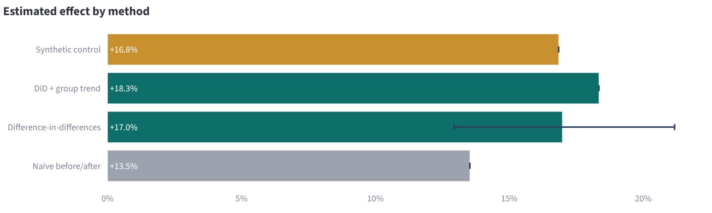 | 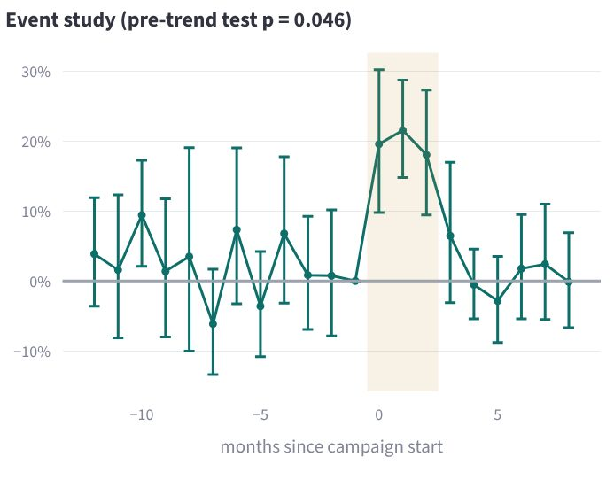 | 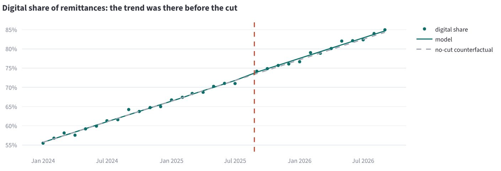 |
| **Churn: churners captured by risk decile** | **Forecast: Ramadan moved 11 days** | **A/B test: CUPED narrows the CI** |
| 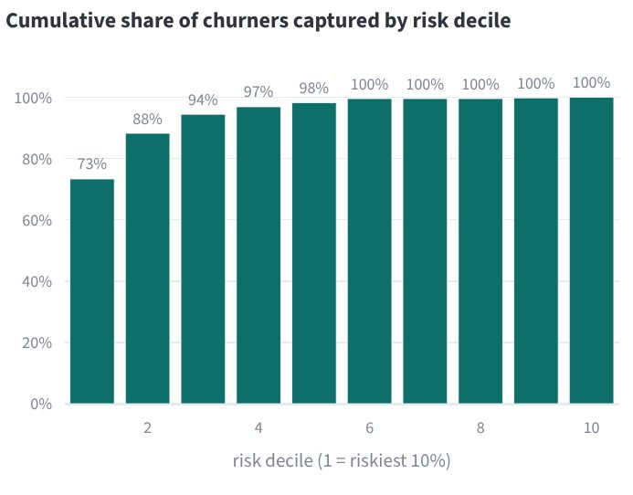 | 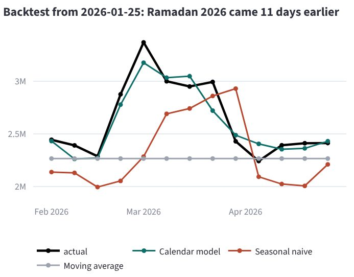 | 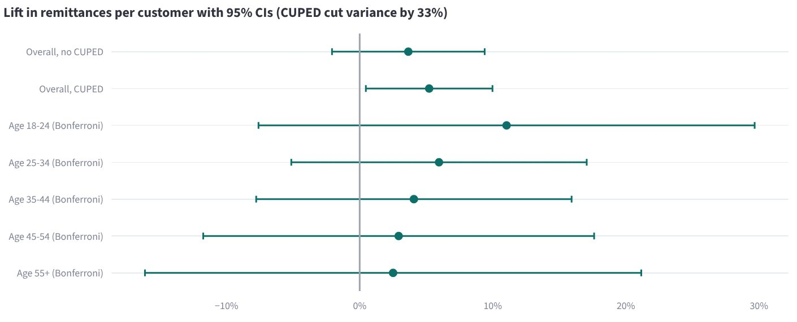 |

```bash
python -m bi_agent.ds                    # run all five modules → reports/ds/lab_report.md, churn_model_card.md
python -m bi_agent.ds validate --strict  # 17 checks against the planted truth (CI gate)
```

Governance carries over: every query is a reviewed SQL template that passes the same SQL guard as the agents; gender and nationality are never model inputs (only used to audit fairness); finance status is excluded because it would leak the future; the UI shows aggregates only. In the app, open **Data Science Lab** in the sidebar. The lab is also the **eighth agent** in the business review, so its findings reach the executive briefing through the same verifier.

## Training the agents (human-in-the-loop)

The agents are not trained like ML models: no weights change, so every number stays auditable. They learn through governed knowledge that is reviewed like code:

```
use the app + rate 👍/👎  →  scripts/train_from_feedback.py  →  scripts/teach.py  →  make test + make evals  →  publish
```

- Every question and rating is logged to `data/feedback/log.jsonl` (question text, status and plan only; never results).
- `python scripts/train_from_feedback.py` writes `reports/training_report.md`: questions the agent could not map (with the unknown words and ready-to-run commands), 👎 answers to review, 👍 answers that should become golden questions, and blocked questions to check for false positives.
- `scripts/teach.py` applies a change safely. It validates the semantic layer, refuses ambiguous synonyms and rolls back invalid edits:

```bash
python scripts/teach.py synonym npf_ratio "kredit macet" --check     # new business word (any language)
python scripts/teach.py alias "kartu debit" product "Mada Debit Card"
python scripts/teach.py golden "kredit macet per wilayah"            # lock the behaviour as a regression test
```

New metrics, impact hypotheses and calendar events are YAML edits too (see [docs/APPENDIX.md](docs/APPENDIX.md) §D, §T and §U).

## Governed metrics

15 metrics across 5 models, all defined in [`semantic/semantic_layer.yaml`](semantic/semantic_layer.yaml), each with an owner and a definition:

| Area | Metrics |
|---|---|
| Transactions | transaction volume, transaction count, average ticket, digital adoption rate, active customers |
| Islamic finance | finance disbursed (Murabaha / Ijarah), outstanding portfolio, **NPF ratio (90+ DPD)**, finance contracts |
| Remittances | remittance volume, count, fee income (by corridor: Indonesia, India, Pakistan, ...) |
| Customers | total customers, new customers, churned customers |

Dimensions include segment, nationality group, age band, gender, region, city, branch, product, product category, channel, transaction type, corridor and finance status. The validator knows which dimensions are valid for which metric.

## Quality: tests and evals

```bash
make test     # 94 unit/integration tests (compiler, guardrails, planner, both LangGraph flows, mocked Claude paths,
              #   training tools, data-science leakage and recovery tests, all three UI pages)
make evals    # 28 golden questions → evals/report.md
make ds       # 17 data-science checks against the planted truth → reports/ds/validation.md
```

| Measure (rule-based planner) | Result |
|---|---|
| Plan accuracy (metric, dimensions, time, filters) | 100% |
| Answer accuracy vs. independent reference SQL | 100% |
| Guardrail and clarification cases | 100% |
| Median latency | ~15 ms |

*Honest note:* the golden set was written alongside the rule planner, so it is in-distribution. Unseen phrasings will score lower. That is why the Claude planner exists and why the same harness can evaluate it (`python evals/run_evals.py --planner llm`).

## Project structure

```
├── scripts/
│   ├── generate_data.py         synthetic star schema → DuckDB
│   ├── setup_mac.sh             one-command install + checks (+ --run)
│   ├── publish_github.sh        one-command commit + push
│   ├── train_from_feedback.py   feedback log → training report
│   └── teach.py                 safely add synonyms, aliases, golden questions
├── semantic/
│   ├── semantic_layer.yaml      governed metrics, dimensions, joins, governance rules
│   ├── impact_links.yaml        cross-business hypotheses with owners and actions
│   └── business_calendar.yaml   Ramadan, Eid, pricing events
├── bi_agent/
│   ├── semantic.py              load + validate the semantic layer
│   ├── plan.py                  QueryPlan + validation (the agent's only output format)
│   ├── compiler.py              QueryPlan → parameterised SQL (CTEs for multi-fact)
│   ├── guardrails.py            input guard, SQL guard, small-cell suppression
│   ├── planner_rules.py         offline planner (synonyms, dates, top-N, follow-ups, repair)
│   ├── planner_llm.py           Claude planner (tool use with enum schema) + summary
│   ├── insights.py              verified facts + chart selection
│   ├── graph.py                 LangGraph state machine (question → answer)
│   ├── cli.py
│   ├── data_setup.py            builds or upgrades the database on first start
│   ├── ds/                      Data Science Lab
│   │   ├── features.py          point-in-time customer features (leakage-tested)
│   │   ├── churn.py             churn model, calibration, fairness, reason codes, economics, model card
│   │   ├── causal.py            DiD, randomisation inference, event study, synthetic control, ITS
│   │   ├── forecast.py          Hijri-calendar forecast with rolling backtests and intervals
│   │   ├── experiment.py        A/B readout: SRM, CUPED, HTE, guardrail, power, A/A
│   │   ├── segments.py          k-means with silhouette and bootstrap stability
│   │   └── lab.py               runs everything, caches, validates against planted truth, reports
│   └── orchestrator/            multi-agent business review
│       ├── graph.py             supervisor + parallel fan-out (Send) + verifier loop
│       ├── domains.py           five domain analyst agents
│       ├── links.py             impact analyst (timeseries, cross-section, cohort, event tests)
│       ├── discovery.py         KPI pair scan
│       ├── report.py            synthesizer (briefing + markdown)
│       ├── verifier.py          grounding / causal-language / evidence checks
│       ├── stats.py             permutation tests, lags, bootstrap, robust z
│       └── tools.py             governed_query + approved_analysis (the only data tools)
├── app/streamlit_app.py         chat UI (answer · chart · table · SQL · plan · trace)
├── app/pages/2_Business_Review.py  multi-agent review: impact map, evidence, heatmap, trace
├── app/pages/3_Data_Science_Lab.py causal, churn, forecast, A/B, segments, validation, model card
├── evals/                       golden questions, runner, report
├── tests/                       pytest suite
├── docs/APPENDIX.md             full build guide: how and why every part was made
├── docs/PANDUAN_ID.md           run, deploy and train guide (Indonesian)
├── docs/presentation/           43-slide deck (.pptx + .pdf)
├── docs/examples/               sample multi-agent briefing
└── .github/workflows/ci.yml     tests + evals + business review on every push
```

## Mapping to an enterprise stack

The pattern is tool-agnostic. In production, the YAML semantic layer would be replaced by:

- **Power BI / Microsoft Fabric**: semantic model measures (DAX) queried via XMLA or the Fabric data agent
- **dbt Semantic Layer (MetricFlow)**: metrics queried through the semantic layer API
- **Denodo**: derived/interface views exposed as REST data services, with Denodo's own security
- **Databricks**: Unity Catalog metric views and Genie
- **DuckDB → Snowflake / Oracle / Cloudera Impala**: only the connector in `db.py` changes

See [docs/APPENDIX.md](docs/APPENDIX.md), section O, for details.

## Roadmap

- [ ] Expose the agent as an **MCP server** so any assistant can query governed metrics
- [ ] Arabic question support (bilingual synonyms + Claude)
- [ ] Metric lineage view (question → metric → columns → tables)
- [ ] Held-out eval set written by a second person
- [ ] Uplift model on a randomised retention experiment (who changes their mind when called, not just who is at risk)

## Author

**Ahmad Zulfikar Rafsanjani**, BI & Data Analytics leader (15+ years: banking, telecom, ERP). CDMP Master · DP-600 · DP-700 · PL-300.
[GitHub](https://github.com/vickarzz) · LinkedIn: *add your profile URL*

Licensed under MIT.
